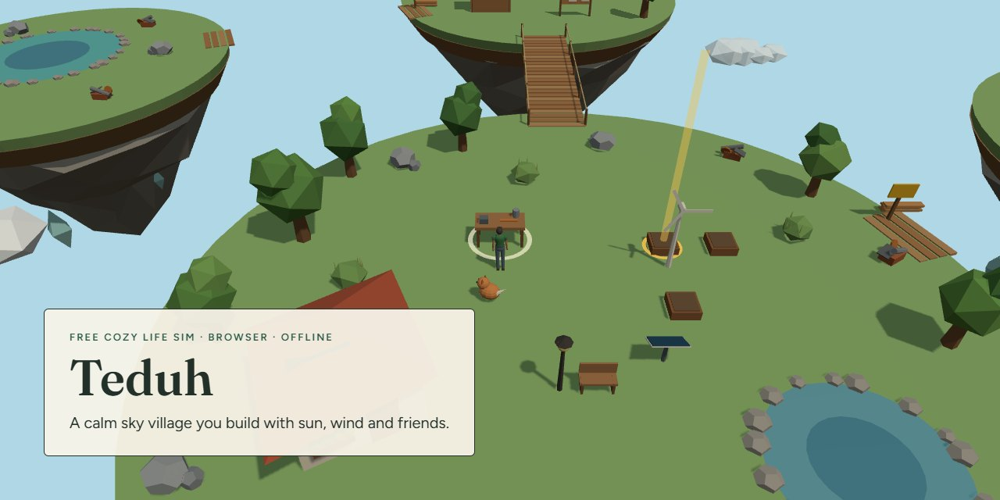
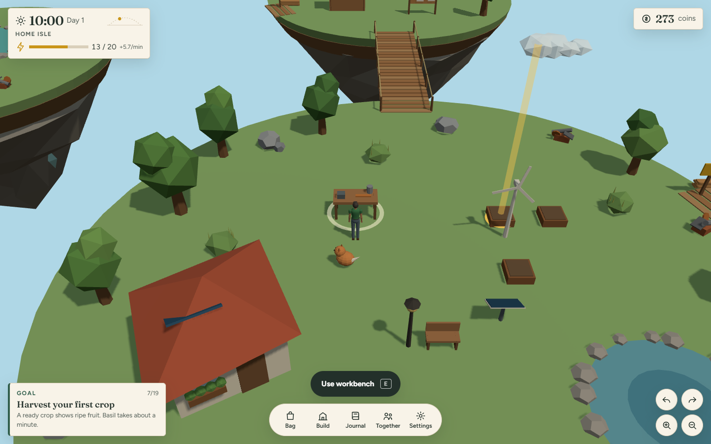

<!-- HERO:START -->

  

  <b>A calm sky village you build with sun, wind and friends.</b> 
  A free, cozy solarpunk life sim that runs in any browser, on phone or desktop, and keeps working offline. No account, no shop.

  <a href="https://juw12.github.io/teduh/"><b>Play it now</b></a> ·
  <a href="#see-it-in-action">See it in action</a> ·
  <a href="#highlights">Highlights</a> ·
  <a href="https://juw12.github.io/p/teduh/">Landing page</a> ·
  <a href="https://github.com/juw12">More by juw12</a>

  
  
  
  
  
  

<table>
  <tr>
    <td width="33%" valign="top">
      <b>Make someone who looks like you</b> 
      A character creator with a live 3D preview: 14 choices across body, face, hair and clothes, including 8 skin tones, a hijab, batik and sarong.
    </td>
    <td width="33%" valign="top">
      <b>Run your island on sun and wind</b> 
      Solar panels charge by day, turbines spin day and night, batteries store it, and stoves, sprinklers and lamps use it.
    </td>
    <td width="33%" valign="top">
      <b>Build the village together</b> 
      Four community projects open new islands. Friends in your room see each other and their deliveries count toward your projects.
    </td>
  </tr>
</table>

## See it in action

   
  Play at <a href="https://juw12.github.io/teduh/">juw12.github.io/teduh</a>. Works on phones (tap to walk) and desktops (WASD).

<!-- HERO:END -->

## About

Teduh (Indonesian for "sheltered, calm") is a cozy life sim set on floating islands above the clouds. You start with
two planters, a workbench and a small house, and a guided list of 25 goals walks you from your first chopped tree to
lighting the village lighthouse. Everything runs on clean energy you build yourself.

It is made as a free answer to [Loftia](https://loftia.gg/), the solarpunk life-sim MMO that entered Early Access on
3 November 2026. Loftia is a much bigger game with a full team, art and a real MMO world. Teduh keeps the parts of that
idea that matter for a calm session and removes the friction reviewers complained about.

## Teduh and Loftia, side by side

| | Teduh | Loftia (Early Access, Nov 2026) |
|---|---|---|
| Price | Free | USD 29.99 on Steam and Epic |
| In-game shop | None. Every hat and item is earned in play | Optional cosmetic shop on top of the price |
| Platforms | Any modern browser: Windows, Mac, Linux, Android, iPhone, ChromeOS | PC and Mac; Switch planned for 2027 |
| Install | None; optional "install as app" (about 1 MB plus a 0.7 MB 3D engine) | Store download |
| Offline | Yes, after the first visit | Always online |
| Servers and lag | No game server; friends connect browser to browser | Reviews report server lag and frequent loading screens |
| First 10 minutes | 25 guided goals with a pointer in the world | Reviews describe a slow early economy |
| Account | None | Store and game account |
| Languages | English and Bahasa Indonesia | See store page |
| Pollution cleanup | 8 smog heaps on 4 islands; each one recycles into materials and clears the sky haze; a clean island blooms | Core loop: recycling and renewable energy clean a polluted world |
| Animal rescue | 3 animals (hen, goat, turtle) trapped in smog; they move to Home Isle and leave a gift every day | Rescue and companion animals, a much larger roster |
| Islands | 44 (4 home islands plus 40 Far Skies islands in 8 biomes) | 3 districts |
| Crops | 64 | 50 |
| Fish | 30 | 28 |
| Animals | 123 to rescue (hen, goat, turtle plus 120 Far Skies animals in 12 species and 10 colourings) | 115 pets |
| Recipes | 1,070 | 736 |
| Villagers | 33 | 30 NPCs |

Loftia facts come from its [store and launch pages](https://loftia.gg/early-access/) and early reviews
([Game8](https://game8.co/reviews/loftia/loftia-review-early-access), [Massively Overpowered](https://massivelyop.com/2026/11/05/loftias-early-access-earns-some-respectable-reviews-and-player-counts-as-the-devs-list-known-issues/)).
Loftia counts come from fan wikis and databases (wikily.gg, interactivemap.app) in November 2026 and will change as it updates. Since 1.5.0 Teduh has more islands, crops, fish, animals, recipes and villagers than those counts; most of the extra come from variants (crop cultivars, dish pairings, animal colourings, islands built from 8 biomes). What Loftia still does better: a large shared world that many players live in at once, hand-made art and animation by a full team, deeper housing and pets you can customise. Its characters are stylised; Teduh's are built to look like real people, with more body, face and clothing choices than a colour swap.

## Features

| Area | What you can do |
|---|---|
| Character creator | Live 3D turntable with body and face views; build, 5 heights, 3 face shapes, 8 skin tones, eye colour, 10 hairstyles (including hijab, bun and curls), hair colour, facial hair, 5 tops (tee, long sleeve, tank, batik, jacket), 4 bottoms (trousers, shorts, skirt, sarong), cloth and shoe colours; 6 ready-made starting looks; change it any time in Settings |
| How to play guide | Five steps pictured with real in-game renders, shown before your first game (skippable) and reopenable from the title screen or Settings |
| Islands | Home Isle, Market Isle, Grove Isle (after the sky bridge) and Reef Isle (after the reef dock), with a day and night cycle and rain |
| Far Skies | Build the skyway on Grove Isle to open 40 more islands in 8 biomes (meadow, autumn, mesa, frost, mangrove and more), each with its own colours, trees, pond fish, smog heaps and animals; 30 have a villager |
| Gathering | Trees, rocks, scrap piles, bushes and berry bushes that regrow |
| Farming | Planters, 64 crops (16 kinds plus 3 cultivars each), watering, compost for faster growth, sprinklers; crops keep growing while you are away (up to 30 minutes) |
| Energy | Solar panels, wind turbines, batteries; cooking, sprinklers and lamps use stored energy |
| Crafting | 1,070 recipes across the workbench, solar cookstove and composter; the cookstove has a search box |
| Fishing | Timing game in the home pond, the reef pool and Far Skies ponds; 30 fish, with different fish in each biome |
| Cooking | Over 1,000 dishes (soups, grills, curries, salads and more from any two ingredients), each with a 3 minute boost (faster crops, double gathering, wider catch zone, faster walking) |
| Building | Place, rotate, move and pick up 14 kinds of furniture and machines on your island grid |
| Villagers | Sari, Bayu and Lin post a new order every morning; friendship unlocks a gift from each; 30 more villagers live in the Far Skies |
| Community projects | Sky bridge, wind tower, reef dock, lighthouse |
| Clean skies | 8 smog heaps to clear across the islands; each recycles into scrap, stone, fiber and sometimes wire; the sky haze lifts as you go and every fully cleaned island blooms with flowers and pays 40 coins; progress in Journal, Clean skies |
| Rescued animals | A sky hen, cloud goat and moss turtle are trapped in smog heaps; once freed they live on Home Isle and leave a daily gift (tomato seeds, fiber, compost). 120 more animals wait in Far Skies smog |
| Skills | Gardening, foraging, crafting, engineering, fishing, cooking (level 1 to 10) |
| Kopi | A small sky fox who follows you, likes pats and fish, and sometimes finds things |
| Play together | Open plaza or private room code; see other players, say preset phrases, pool project deliveries |
| Saves | Automatic local save, plus a save code to move your island to another device |

## How to play

1. Open [juw12.github.io/teduh](https://juw12.github.io/teduh/), type a name and press Start.
2. Read the five-step How to play guide (or skip it; it is always in Settings), then make your character and press Begin.
3. Follow the goal card at the bottom left. A gold beacon in the world shows where to go.
4. Walk with WASD or the arrow keys, or tap the ground. Press E, Space or the action button to act.
5. Q and R turn the camera; on a phone, drag with two fingers. B opens the bag, C build mode, J the journal.
6. To install it as an app, open Settings and choose "Install as an app" (Chrome, Edge, Android), or use "Add to Home Screen" on iPhone.

## Play together and privacy

Playing together is opt-in. It uses [Trystero](https://github.com/dmotz/trystero) (WebRTC) with public Nostr relays
only to introduce browsers to each other; there is no Teduh server. Shared data: your display name, character look (only the preset choices, checked on arrival), hat,
position, preset phrases and project deliveries. Like any video call, other players' browsers can see your IP address.
There is no free text chat, so nobody can send you anything except the preset phrases.

Your save stays in your browser (localStorage). Nothing is uploaded.

## Tech

Plain JavaScript modules, [three.js](https://threejs.org/) r160 (bundled), no build step and no runtime dependencies
from the network. Fonts (Fraunces, Figtree; SIL Open Font License) are bundled for offline play. Design rules are in
[design.md](design.md).

| File | Purpose |
|---|---|
| `js/data.js` | Items, crops, recipes, islands, projects, villagers, goals |
| `js/farskies.js` | Far Skies: biomes, cultivars, dishes, far islands, animals and villagers, expanded from a fixed seed |
| `js/state.js` | Game rules as pure functions over a JSON save |
| `js/world.js` | 3D world built from primitives |
| `js/look.js`, `js/character.js` | Character choices and the sanitiser; the jointed, animated 3D person and the creator preview |
| `js/onboard.js` | How to play guide and character creator |
| `js/ui.js`, `js/i18n.js` | Interface and English/Indonesian text |
| `js/net.js` | Peer-to-peer rooms |
| `tests/run_tests.py` | Browser test suite (Playwright) |
| `tests/guide_shots.py` | Re-renders the How to play pictures from the game itself |

Run locally: `python -m http.server` in this folder, then open `http://localhost:8000/`.
Run the tests: `python tests/run_tests.py` (needs `pip install playwright` and Chrome).

## License

MIT. See [LICENSE](LICENSE). three.js and Trystero are MIT; Fraunces and Figtree are SIL OFL 1.1.
